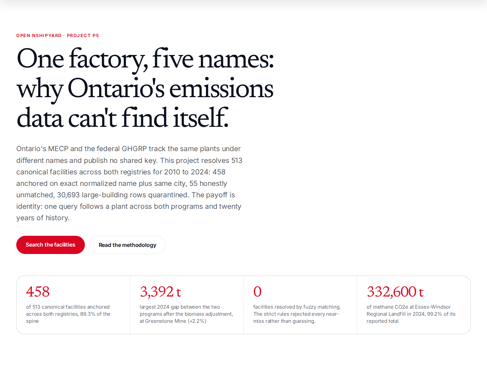
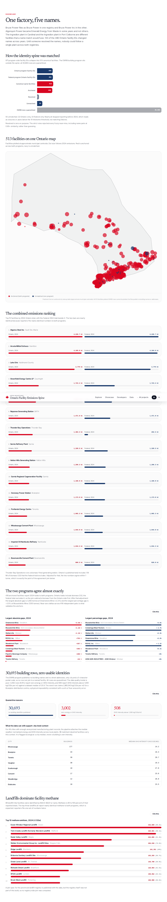
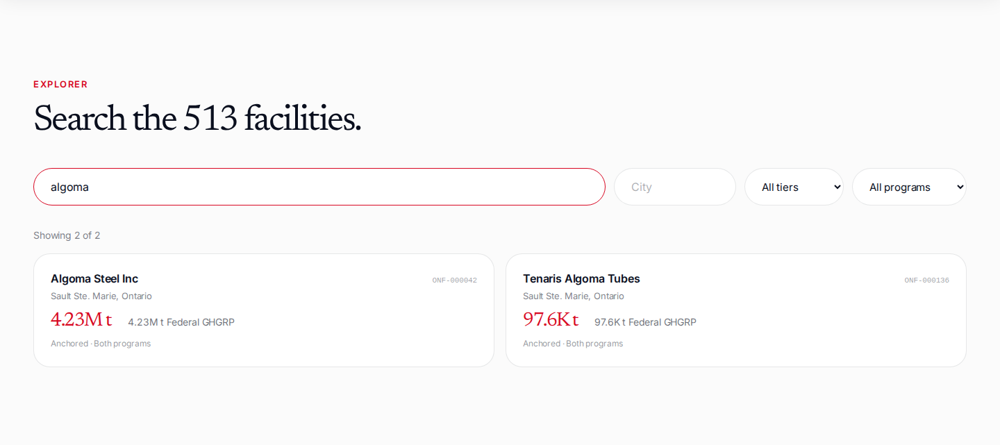
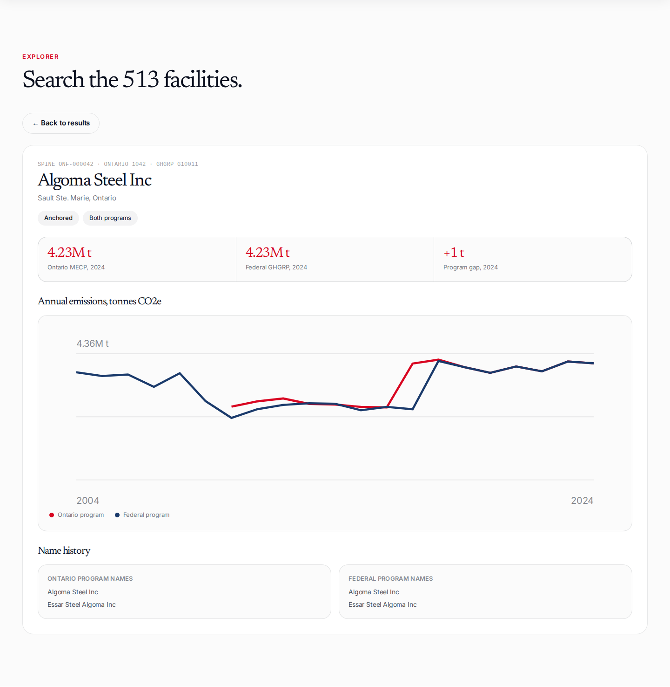

# ontario-facility-emissions

**Ontario Facility Emissions Spine: one factory, five names.** Open Nshipyard project P5.

Ontario's MECP greenhouse gas registry and the federal GHGRP name the same facilities differently and publish no shared key. This project resolves 513 canonical Ontario facilities across both programs for 2010 to 2024: 458 anchored on exact normalized name plus same city (89.3%), 0 resolved (the strict rules rejected every fuzzy near-miss rather than guessing), 55 honestly unmatched, and 30,693 large-building rows quarantined because the EWRB program publishes no building names or street addresses.

An open-source civic project. Not affiliated with the Government of Ontario or the MECP.

Proposed domain: `emissions.canada.nshipyard.com`.

## Screenshots

Screenshots live in `docs/screenshots/` (captured during the verification loop):









## What the data shows

- 458 of 513 canonical facilities anchor across the MECP and federal GHGRP programs (89.3%). 55 are unmatched: 22 Ontario-only, 33 federal-only, nearly all stopped reporting before 2024. Resolved is zero on purpose.
- The agreement join is the validation: 416 anchored facilities report 2024 totals to both programs, and after subtracting biomass CO2 from the Ontario side, the largest gap is 3,392 tonnes at Greenstone Mine (+2.2%) and the largest percentage gap is +3.5% at Musselwhite Mine (1,105 tonnes).
- **Algoma Steel Inc** (Sault Ste. Marie) is the top emitter: 4,226.7 kt CO2e in 2024, then ArcelorMittal Dofasco at 4,165.9 kt.
- Landfills dominate facility methane: 89 landfill-like facilities emit 90 to 100% methane. **Essex-Windsor Regional Landfill** emitted 332,600 t CO2e of methane in 2024 (99.2% of its total).
- The EWRB large-building program cannot join at record level: all 30,693 rows (9,250 buildings, 2018-2024) are quarantined. 3,002 rows (9.8%) report zero intensities; 508 report GHG intensity above 1,000 kgCO2e/m2 against a median of 25.9. 96 industrial facilities carry city-level manufacturing context instead, flagged ecological.
- 128 year-over-year anomalies flagged (jumps above 200% or drops above 75% on bases above 1,000 t). Largest: Rainy River Mine 2018 to 2019, 4,660 to 146,180 t (+3,037%), a mine ramping up.

## Files

- `public/data/spine.json` / `spine.csv` - 513 canonical facilities: per-program name variants, 2024 totals, annual series, EWRB context where attached
- `public/data/top_emitters.json` - top 30 Ontario 2024 emitters
- `public/data/joins/ghg_vs_ghgrp.json` - 416 matched 2024 pairs with deltas, top absolute and percentage deltas
- `public/data/joins/ewrb_joined.json` - 49 city manufacturing-intensity contexts and the 25 largest emitters carrying them
- `public/data/joins/landfill_methane.json` - landfill methane ranking plus the provincial registry join spec
- `public/data/joins/merges.json` - all 458 merges with ratios and raw name pairs
- `public/data/anomalies.json` - 128 year-over-year flags
- `public/data/examples.json` - 9 curated entity-resolution cases: 5 clean merges, 4 correctly rejected near-misses
- `public/data/stats.json`, `match_funnel.json` - tier and coverage counts
- `public/data/FINDINGS.md` - the full findings writeup from the data pipeline
- `scripts/build_spine.py` - the reproducible pipeline; `scripts/make_examples.py` - the curated examples

## Methodology

Sources (retrieved 2026-10-10): Ontario MECP Greenhouse Gas Emissions Reporting By Facility 2010-2024 (Reg 390/18, Ontario Open Government Licence), Ontario Ministry of Energy and Mines large-building energy and water usage files 2018-2024, and ECCC GHGRP Emissions by Gas 2004-2024 (federal Open Government Licence - Canada). Anchor matching on exact normalized name plus same normalized city. Merge-trap rules: a site suffix equal to the city can never anchor a merge, conflicting site suffixes veto the merge, full-name anchors are assigned before sub-form matches. The fuzzy tier produced zero merges after the strict rules. EWRB quarantined at record level because the files publish no building names or street addresses; city-level manufacturing context is ecological, never building-level. Ontario's published total includes biomass CO2 and the federal total excludes it: the 2024 join adjusts for this, and any reuse of the raw totals must do the same. Full detail: the methodology section on the site (EN+FR), `docs/datafix-entry.md`, `public/data/FINDINGS.md`.

## Develop

```bash
npm install
npm run dev
```

## API

REST under `/api/v1/`:

- `GET /api/v1/spine` - full spine: 513 canonical facility rows
- `GET /api/v1/search?q=algoma&city=hamilton&tier=anchored&program=both&limit=50` - search with name/city/tier/program filters
- `GET /api/v1/stats` - match statistics, funnel, unmatched split, top-30 emitters, EWRB quarantine, landfill methane, 2024 agreement deltas
- `GET /api/v1/facility/ONF-000042` - full record: both programs' name histories, annual series, 2024 totals, delta, EWRB context, methane and anomaly flags
- `GET /api/v1/facility/points` - slim coordinate set for the match map

OpenAPI 3.1 spec at `/api/openapi.json`.

MCP (streamable HTTP, JSON-RPC 2.0): `POST /mcp` with tools `facility_lookup`, `spine_search`, `match_stats`.

## Author

**Richardson Dackam** - [X (@richardsondx)](https://x.com/richardsondx) · [GitHub](https://github.com/richardsondx)

## License

MIT. Source data: Ontario MECP facility GHG reporting (Ontario Open Government Licence), Ontario Ministry of Energy and Mines large-building files, and Environment and Climate Change Canada GHGRP emissions by gas (Open Government Licence - Canada). The spine and derived tables are original work.
